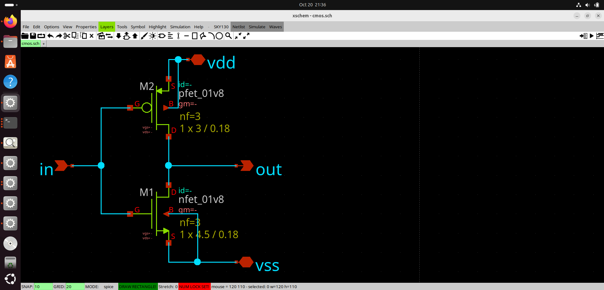
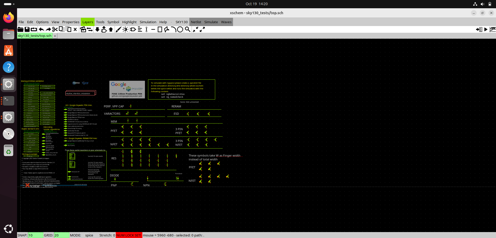
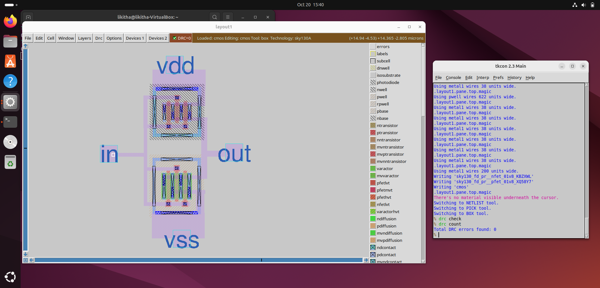

# SKY130A CMOS Inverter Design and Physical Verification

## About the Project

This project is part of my VLSI Design Engineer screening task. The aim was to understand the CMOS inverter design flow using the open-source SKY130A PDK and tools such as Xschem and Magic.

I worked on creating the CMOS inverter schematic, generating the SPICE netlist, and building the physical layout in Magic. I have also generated extraction and comparison files as part of the verification process.

## Tools Used

- Xschem for schematic design
- Magic VLSI for physical layout
- SKY130A PDK for the transistor models and layout technology
- SPICE for the circuit netlist and testbench

## About the CMOS Inverter

A CMOS inverter consists of a PMOS transistor and an NMOS transistor. The PMOS is connected to the positive supply, while the NMOS is connected to ground.

The circuit has four main connections:

- `in` – input signal
- `out` – output signal
- `vdd` – positive supply
- `vss` – ground

When the input is LOW, the output should be HIGH. When the input is HIGH, the output should be LOW.

## Work Done

### 1. Understanding the SKY130A PDK
I explored the SKY130A technology and the tools used in the physical design and verification flow.

### 2. Schematic Design
I created the CMOS inverter schematic in Xschem and generated the corresponding SPICE netlist.

### 3. Transistor Layout
I worked with the NMOS and PMOS device layouts using the SKY130A technology files.

### 4. Physical Layout
I imported and worked on the inverter layout in Magic. The layout and transistor cell files are included in this repository.

### 5. Extraction and Verification
I generated extraction and comparison outputs while working on the verification flow. The final DRC and LVS status will be documented based on the actual reports.

## Project Files

- `01_Schematic/` – Xschem schematic
- `02_SPICE_Netlist/` – CMOS inverter netlist and testbench
- `03_Magic_Layout/` – Magic layout and transistor cell files
- `04_Verification/` – Extraction and comparison outputs

Additional folders are included for documenting the different stages of the screening task.

## What I Learned

Through this task, I gained practical experience with the CMOS inverter design flow, working with the SKY130A PDK, generating SPICE netlists, and using Magic for physical layout. I also became familiar with the importance of checking layout rules and comparing the layout with the schematic.

## Reference

The following repository was used as a reference for understanding the physical verification flow:

https://github.com/yathAg/Physical_Verification_SKY130A

## SKY130A CMOS Inverter Design and Physical Verification

### Tools Setup

### Overview

This project demonstrates the design and physical verification of a CMOS inverter using the SkyWater SKY130A open-source Process Design Kit (PDK).

The workflow uses open-source Electronic Design Automation (EDA) tools for circuit simulation, physical layout design, Design Rule Checking (DRC), and Layout Versus Schematic (LVS) verification.

### Tools Required

The following tools are used in this project:

Tool| Purpose
Magic| CMOS layout design, extraction, and DRC
Netgen| Layout Versus Schematic (LVS) comparison
ngspice| Circuit simulation and waveform analysis
Xschem| Schematic capture and SPICE netlist generation
SKY130A PDK| Process technology files, device models, and design rules

Open_PDKs provides the technology integration needed to use the SKY130 process with supported EDA tools.

### Operating Environment

The project was carried out in an Ubuntu Linux environment with the SKY130A PDK and the required EDA tools.

The tools were used to create and simulate a CMOS inverter, construct its physical layout, and perform physical verification.

### Checking Tool Installation

The following commands can be used to check whether the main tools are available in the terminal:

magic -version

ngspice --version

netgen -batch

xschem --version

The exact supported options may vary by installed version. If a version command is unsupported, check the tool's help output or launch the application directly.

The SKY130A PDK files can be checked using:

ls /usr/local/share/pdk/sky130A/

If your PDK is installed in a different directory, use its actual installation path.

### Tool Roles in the Verification Flow

Magic: Used to create and inspect the CMOS inverter layout, run design rule checks, and extract the layout netlist.

Netgen: Used to compare the schematic and extracted layout netlists to identify connectivity or device mismatches.

ngspice: Used to simulate the inverter and observe its input and output voltage waveforms.

Xschem: Used to draw circuit schematics and generate SPICE netlists when required.

SKY130A PDK: Supplies technology-specific layer definitions, transistor models, and design rules needed for the design and verification process.

### Verification Workflow

The project follows this sequence:

1. Understand the SKY130A process and the EDA tools.
2. Prepare the circuit schematic and SPICE netlist.
3. Simulate the CMOS inverter using ngspice.
4. Create the physical layout in Magic.
5. Run Design Rule Checking (DRC).
6. Extract the layout netlist.
7. Compare the schematic and extracted netlists using Netgen.
8. Document the results with screenshots and verification reports.

### Installation References

Official and reference resources:

- Magic: http://opencircuitdesign.com/magic/
- Netgen: http://opencircuitdesign.com/netgen/
- Xschem: https://xschem.sourceforge.io/
- ngspice: https://ngspice.sourceforge.io/
- SkyWater PDK: https://github.com/google/skywater-pdk
- Open_PDKs: https://github.com/RTimothyEdwards/open_pdks

### Verifying the open_pdk installation

An initial working directory can be created to organize the files required for Magic, Netgen, and Xschem.

### Creating the working directories

mkdir -p ~/sky130_lab
cd ~/sky130_lab

mkdir -p mag
mkdir -p netgen
mkdir -p xschem

### Checking the SKY130A PDK installation

Verify that the SKY130A PDK is available at the default installation path:

ls /usr/local/share/pdk/sky130A/

### Check the configuration files required by the EDA tools:

ls /usr/local/share/pdk/sky130A/libs.tech/magic/sky130A.magicrc

ls /usr/local/share/pdk/sky130A/libs.tech/xschem/xschemrc

ls /usr/local/share/pdk/sky130A/libs.tech/ngspice/spinit

ls /usr/local/share/pdk/sky130A/libs.tech/netgen/sky130A_setup.tcl

### Copying the configuration files

If the files exist at the specified paths, copy them into the working directories:

cp /usr/local/share/pdk/sky130A/libs.tech/magic/sky130A.magicrc \
   ~/sky130_lab/mag/.magicrc

cp /usr/local/share/pdk/sky130A/libs.tech/xschem/xschemrc \
   ~/sky130_lab/xschem/xschemrc

cp /usr/local/share/pdk/sky130A/libs.tech/ngspice/spinit \
   ~/sky130_lab/xschem/.spiceinit

cp /usr/local/share/pdk/sky130A/libs.tech/netgen/sky130A_setup.tcl \
   ~/sky130_lab/netgen/

### Checking the EDA tools

Confirm that the required tools are available:

which magic
which netgen
which ngspice
which xschem

Each command should return the executable path if the corresponding tool is installed and available in the system's PATH.

Result

The working directory is prepared with separate folders for Magic, Netgen, and Xschem, and the relevant SKY130A PDK configuration files are copied into place.

### Screenshot Evidences

### Checking if Magic Works

The Magic layout editor was launched to verify that the tool was available in the configured environment.

### Checking if ngspice Works

The CMOS inverter was simulated using ngspice to observe the input and output waveforms.

"Ngspice simulation waveform" (images/ngspice-waveform.png)
### Checking if Netgen Works

### Checking if Xschem Works
### CMOS Inverter Schematic

### Final Magic Layout

### Transient Waveform

### Design Rule Check (DRC)

### Layout Versus Schematic (LVS)

